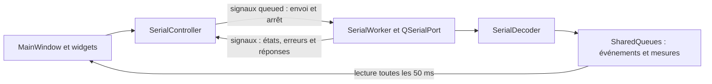

# Architecture de SoftPorteBlum

L'application sépare l'interface et les entrées/sorties série. Le thread de travail décode les trames et publie des événements immuables ; le thread de l'interface possède les widgets et leurs historiques de mesures.

## Démarrage

`Application` charge le thème, affiche le splashscreen et initialise la configuration de l'application via `AppSettings`. Les états, codes, courbes et styles de debug sont chargés une seule fois depuis les ressources intégrées, avant la liaison série et les widgets. Une erreur de chargement interrompt le démarrage. Les noms des états sont également initialisés avant le worker.

`AppSettings` lit les valeurs INI intégrées et leurs surcharges à côté de l'exécutable. Voir [Config.md](Config.md).

## Répartition des responsabilités

| Composant | Responsabilité |
| --- | --- |
| `src/Application.*` | Initialisation et durée de vie de l'application. |
| `src/gui/MainWindow.*` | Onglets, statut, notifications, ouverture CSV et distribution des mesures. |
| `src/serial/SerialController.*` | Découverte des ports, préférences, état confirmé et cycle de vie du thread. |
| `src/serial/SerialWorker.*` | Port série, temporisations, commandes et réception dans un `QThread`. |
| `src/serial/SerialDecoder.*` | Reconstruction incrémentale et décodage binaire. |
| `src/core/Event.*` | Événements spécialisés et formatage des messages. |
| `src/core/EventQueue.h` | Historiques partagés protégés par mutex, séquences et pertes. |
| `src/core/MeasurementStore.h` | Stockage borné propre à chaque graphique, dans le thread GUI. |
| `src/core/SystemState.h` | Instantané de connexion, initialisation et acquisition. |
| `src/gui/widgets/` | Pages, graphiques, états, réglages série, PID et consignes. |
| `src/gui/components/` | Cases colorées et aides de style. |

Les inclusions internes sont relatives à `src/`, par exemple `core/Event.h`.

## Communication entre threads

`QSerialPort` et les timers du worker sont créés après son déplacement dans le thread de travail. Le GUI n'accède jamais directement au port. Les signaux critiques sont traités par la boucle GUI sans attendre la prochaine lecture des historiques.

`SharedQueues` contient deux historiques circulaires de 200 objets chacun : événements/commandes et trames M/A. Les lectures sont non destructives et utilisent un curseur indépendant par consommateur. Chaque lot expose son dernier numéro de séquence et le nombre d'entrées perdues avant lecture.

## Mesures et routage

Chaque `GraphiqueWidget` possède un `MeasurementStore` : 2000 trames moteur et 400 trames inertielles au maximum, conservées en valeurs brutes. Les plus anciennes sont remplacées lorsque la capacité est atteinte.

`MainWindow` distribue les nouveaux lots uniquement à la destination Mesures ou Pilotage courante. Debug conserve cette destination et lit séparément les historiques partagés. Les changements d'onglet et l'origine temporelle du pilotage sont décrits dans [Interface.md](Interface.md) et [Pilotage.md](Pilotage.md).

Une nouvelle acquisition Mesures efface son stockage local et avance son curseur au-delà des anciennes trames. Elle conserve l'historique partagé utilisé par Debug. Le pilotage copie les événements dont il ajuste les temps ; les événements partagés restent inchangés.

## État et arrêt

`SerialController` possède `SystemState` et émet `systemStateChanged` lorsqu'un champ change. Les commandes nécessitent `connected && initialized`. Les confirmations de statut et les premières trames reçues actualisent les acquisitions ; l'envoi d'une commande ne vaut pas confirmation.

À la fermeture, le worker tente `SET MESURES OFF` si la carte est initialisée, attend au maximum 300 ms pour vider les écritures, puis ferme le port. Le contrôleur attend la sortie du thread sans `terminate()`. La livraison physique d'une commande reste incertaine après une perte de liaison.

## Vérification

`tests/CoreTests.cpp` couvre notamment les événements, configurations, historiques et décodages. `tests/IntegrationTests.cpp` vérifie les interactions GUI et série. Les cibles CMake `core_tests` et `integration_tests` sont enregistrées dans CTest ; les tests d'intégration utilisent la plateforme Qt `offscreen`.

## Demandes de commandes depuis les pages

`protocol.json` contient une liste de paires `key` / `cmd`, chargée dans `AppSettings`. CMake génère `Protocol::CMD` depuis les clés du JSON ; les pages et signaux utilisent ces identifiants typés (par exemple `Protocol::CMD::SetPidVitesse`). `Protocol::CommandRequest` conserve l'identifiant et les paramètres ; son texte est résolu par `AppSettings::command()`. `Protocol::parseCommand()` retrouve l'identifiant et les paramètres à partir du texte série via ce même dictionnaire.

Les pages Mesures, Pilotage et Debug derivent de `Page`, sans reference a
MainWindow, au controleur ou aux queues du worker. Elles emettent les demandes
`sendCommand(CMD, values, awaitReply)` et `sendRawCommand(text)` telles
quelles ; le controleur seul autorise ou refuse l'envoi.
Les commandes brutes n'attendent jamais de reponse.

`Page` propose des slots virtuels vides `processEvents(batch)`,
`processMeasurements(batch)` et `commandFinished(CMD, accepted)`.
`setSystemState(state)` est virtuel et conserve l'instantane ; chaque page le
surcharge pour actualiser ses boutons. Aucun signal `systemStateChanged` ne
repart de Page. `SystemState::calibration` indique la calibration en cours ;
`resetSequence` change a chaque reset, meme lorsque initialized etait deja false.

MainWindow lit les deux queues avec ses curseurs. Les evenements d'etat sont
toujours transmis a Mesures. Les mesures ne sont transmises qu'a la page active
(Mesures ou Pilotage). Debug ne recoit les nouveaux evenements et mesures que
lorsqu'il est actif ; a chaque activation, MainWindow lui renvoie integralement
les deux historiques encore disponibles. Debug evite les doublons par sequence.

`CalibrationButton` emet une commande apres Oui et la page relaie son signal.
Le pilotage conserve des demandes typees et attend chaque acquittement. Il ne
conserve que deux trames moteur recentes pour choisir la reference temporelle
de l'acquisition, sans lire directement les queues partagees. La sortie du
pilotage attend les acquittements de MESURES OFF puis STOP si necessaire.
Le terminal et les commandes du graphe d'etats utilisent le chemin brut.

## Boutons a deux etats

`TwoStateButton` est un composant commun aux commandes Acquerir/Arreter,
Envoyer/Stopper et Connecter/Deconnecter. `setStateText(bool, texte)` et
`setStateIcon(bool, icone)` definissent la presentation des deux etats.
Le clic bascule l'etat et emet le signal natif `toggled(bool)`. Le slot
`setChecked(bool)` synchronise la presentation, y compris lorsque les signaux
sont bloques. Les mises a jour d'etat depuis la carte ou le pilotage utilisent
`QSignalBlocker` pour ne pas renvoyer de commande. Pour l'acquisition, le clic
exprime une demande et la page restaure l'etat confirme en attendant la carte.
La largeur reservee couvre les deux presentations.
